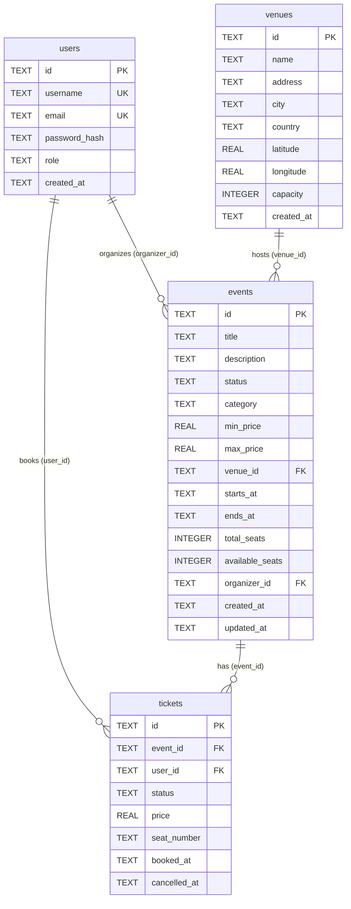

# TicketSphere — Entity Relationship Diagram



## Table Hierarchy

```
users   ←──────── events ────────→ venues
  ↑                   ↑
  └────── tickets ────┘
```

| Level | Tables | Note |
|---|---|---|
| Root | `users`, `venues` | No foreign keys — independent tables |
| Middle | `events` | Depends on `users` (organizer) and `venues` |
| Leaf | `tickets` | Most dependent — references both `users` and `events` |

## Relationships

| Relationship | Cardinality | Foreign Key | Description |
|---|---|---|---|
| `users` → `events` | 1 : N | `events.organizer_id` | One organizer creates many events |
| `venues` → `events` | 1 : N | `events.venue_id` | One venue hosts many events |
| `users` → `tickets` | 1 : N | `tickets.user_id` | One attendee books many tickets |
| `events` → `tickets` | 1 : N | `tickets.event_id` | One event has many tickets |

## Referential Integrity

Deleting a parent record breaks child records (FK constraint in SQLite):

| Delete | Breaks |
|---|---|
| `users` row | Their `events` (organizer_id) and their `tickets` (user_id) |
| `venues` row | All `events` at that venue (venue_id) |
| `events` row | All `tickets` for that event (event_id) |

The `DELETE /api/v1/venues/:id` endpoint explicitly checks for `published` or `draft` events
before allowing deletion to prevent orphaned event records.
